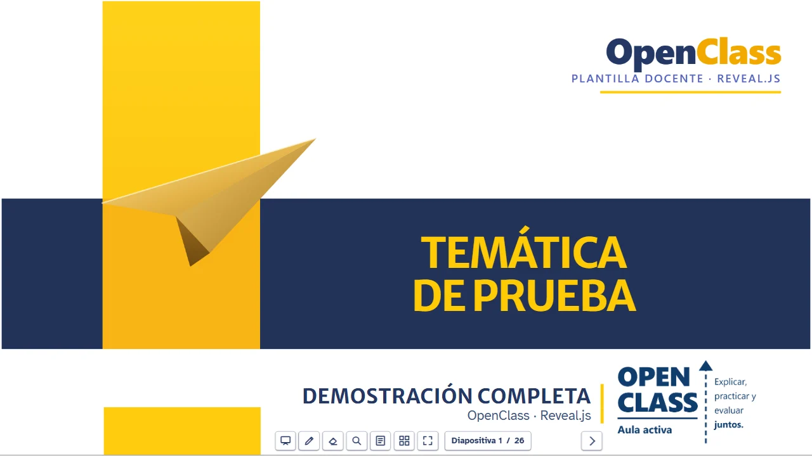

# OpenClass UNIMINUTO · Reveal.js

Generador npm de presentaciones docentes interactivas con **Reveal.js**: un comando crea un curso
completo con portal, hasta ocho semanas, 13 layouts con identidad visual, código con scroll o
paginado, Mermaid, Chart, fórmulas, actividades interactivas y una guía del docente integrada.
El docente escribe **Markdown**; no necesita saber React.



- **Sitio y demostración:** https://herrerawilliamh.github.io/create-openclass-uniminuto-revealjs/
- **Demostración completa:** https://herrerawilliamh.github.io/create-openclass-uniminuto-revealjs/curso/demo-completa/
- **Galería de los 13 layouts:** https://herrerawilliamh.github.io/create-openclass-uniminuto-revealjs/curso/galeria/
- **Guía del docente:** https://herrerawilliamh.github.io/create-openclass-uniminuto-revealjs/curso/guia/
- **Paquete npm:** https://www.npmjs.com/package/create-openclass-uniminuto-revealjs

> Proyecto docente independiente de código abierto; no es un sitio oficial de UNIMINUTO. El
> paquete público usa un **tema neutro** con la misma composición. Los fondos y logotipos
> institucionales no se distribuyen: cada docente autorizado los aplica en su equipo con `--assets`.

## Requisitos

- [Node.js](https://nodejs.org/) **20.19 o posterior** (incluye npm).
- Un editor de texto (VS Code recomendado) y Chrome, Edge o Firefox.

## Instalación y primer curso

```bash
npm create openclass-uniminuto-revealjs@latest mi-curso
cd mi-curso
npm install
npm run dev
```

Se abre el portal en `http://localhost:8600/` con: presentación general, semana 1, demostración
completa, galería de layouts, laboratorio y guía del docente.

Con los recursos institucionales (solo docentes autorizados, carpeta entregada por canal interno):

```bash
npm create openclass-uniminuto-revealjs@latest mi-curso -- --assets "RUTA/recursos-institucionales"
```

## Comandos

En el generador:

| Comando | Efecto |
|---|---|
| `npm create openclass-uniminuto-revealjs@latest <carpeta>` | Crea un curso nuevo (la carpeta debe estar vacía o no existir) |
| `… <carpeta> -- --iot` | Nombre inicial «Introducción a Internet de las Cosas» |
| `… <carpeta> -- --install` | Crea e instala dependencias |
| `… <carpeta> -- --assets <dir>` | Copia imágenes locales (fondos/logotipos) sobre `public/` |
| `npx create-openclass-uniminuto-revealjs@latest <curso> --update-theme` | Actualiza la infraestructura de un curso existente con respaldo, conservando Markdown y configuración |

En un curso:

| Comando | Efecto |
|---|---|
| `npm run dev` | Servidor local con recarga en vivo |
| `npm run semana -- 2 --title "Tema"` | Crea/activa la semana 2 (conserva el Markdown existente) |
| `npm run config` | Regenera rutas de semanas desde `openclass.config.json` |
| `npm run test:estructura` | Verifica archivos obligatorios y semanas activas |
| `npm run build:all` | Compila el sitio estático en `dist/` |
| `npm run preview:pages` | Sirve `dist/` para revisarlo |

## Qué incluye cada curso

- **13 layouts:** portada, separador, resultados, imagen izquierda/derecha, título superior
  izquierdo/derecho, texto, dos columnas, dos títulos, multimedia, código y cierre GRACIAS.
- **Código:** modo scroll (predeterminado, con botón copiar y teclado seguro) y modo paginado
  (`data-oc-paginate="code"`).
- **Plugins:** Markdown, Highlight, Notes, Search, Zoom, KaTeX, Chalkboard, Custom Controls,
  Chart y Mermaid. Exportación PDF con `?print-pdf`.
- **Actividades:** microactividad de clasificación editable (`public/actividades/microactividad/`),
  quiz y laboratorio, dentro de iframes aislados.
- **IA:** `docs/IA/INSTRUCCIONES-OPENCLASS.md`, `PLANTILLA-SEMANAL.md` y `PROMPT-CREAR-SEMANA.md`.
- **Publicación:** flujo de GitHub Actions para GitHub Pages incluido en cada curso.

## Desarrollo del generador

```bash
npm test                    # generador, paginación, demostración, galería y microactividad
npm run test:navegador      # crea un curso, lo compila con base de subcarpeta y lo prueba en Chrome real
npm run site:build          # construye _site/ (landing + curso de demostración) para GitHub Pages
node --test tests/sitio.test.mjs
npm run galeria:capturas -- <dist-de-un-curso>   # regenera las capturas reales de la galería
npm run assets:neutros      # regenera el tema neutro y el video de demostración
```

Estructura: `bin/` (CLI), `template/` (curso que se copia), `site/` (landing de Pages),
`scripts/` (capturas, recursos, sitio y pruebas de navegador), `tests/`, `docs/` y
`graphify-out/` (grafo de conocimiento compartido por los asistentes de IA; ver `AGENTS.md`).

## Limitaciones conocidas

- KaTeX se descarga de un CDN: sin conexión, las fórmulas se muestran como texto.
- Las actividades son locales: no envían resultados a Moodle ni a otros servidores.
- Seminar, Poll y Questions (participación multiusuario) están incluidos pero desactivados.

## Licencia y créditos

Código del generador: [MIT](LICENSE) © 2026 William Herrera. Las dependencias conservan sus
licencias: [Reveal.js](https://revealjs.com/) (MIT), [reveal.js-plugins](https://github.com/rajgoel/reveal.js-plugins)
de Asvin Goel (MIT, en `template/public/vendor/`), [Mermaid](https://mermaid.js.org/) (MIT),
[Chart.js](https://www.chartjs.org/) (MIT), [KaTeX](https://katex.org/) (MIT), React (MIT), Vite (MIT)
y las fuentes Atkinson Hyperlegible y Merriweather Sans (SIL OFL). El tema neutro, las
ilustraciones y el video de demostración son obra original del proyecto (MIT). Las marcas y
logotipos institucionales no forman parte de este repositorio ni se relicencian.
