# OpenClass Live — guía para la clase

Sus diapositivas siguen en su computador. Los estudiantes responden desde el teléfono con un QR o un código; no ven ni descargan la presentación.

En resumen: **todo se hace desde el botón «En vivo» del pie de la presentación**. Muestra solo lo que corresponde a cada momento: conectar → **Iniciar votación · 30 s** → **Mostrar resultados** → **Discutir y repetir** o **Revelar explicación**. No hay que configurar cada pregunta.

> Las capturas son reales, tomadas del servicio funcionando en un equipo de prueba (por eso la dirección es `127.0.0.1`). En clase verá `openclass-live.apps.willedtech.io`.

## Antes de la primera clase (una sola vez)

En su curso, abra `src/plugins/fase2.mjs` y cambie `activa: false` por `activa: true` dentro de `LIVE`:

```js
export const LIVE = {
  activa: true,
  servidor: 'https://openclass-live.apps.willedtech.io',
};
```

Aparece **● En vivo** en el pie azul de la presentación, junto a los demás botones (en la portada, como icono de ondas junto a «siguiente»; atajo: tecla **L**). Mientras no se conecte, la presentación no envía nada a ningún servidor.

## 1. Iniciar OpenClass en su computador

En la carpeta del curso: `npm run dev` y abra la semana como siempre (`http://localhost:8613/...` o el puerto configurado en su curso). No use túneles ni publique la presentación.

## 2. Abrir la sala en el panel docente

Abra `https://openclass-live.apps.willedtech.io/docente/` (mejor en otro monitor, una tableta o el teléfono), escriba la contraseña, ponga un título opcional y pulse **Crear sala**. La sala dura 3 horas y luego se borra sola.

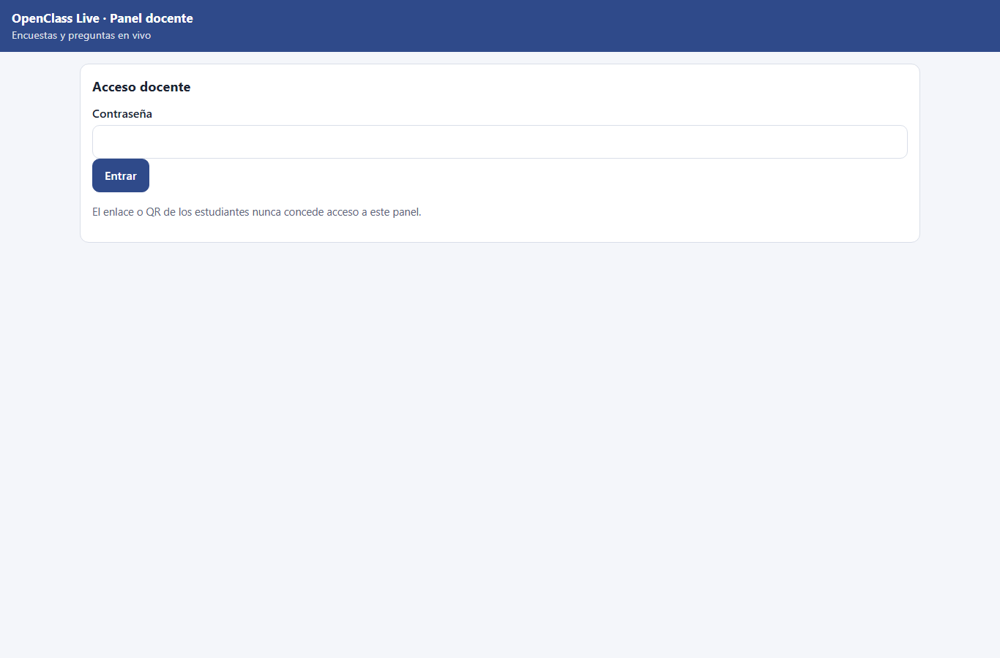

El panel muestra primero lo importante: la sala (código, QR, participantes), la pregunta en curso y sus controles, y las preguntas de los estudiantes. Lo opcional queda plegado al final (**Crear pregunta improvisada**, **Preguntas de esta sesión**, **Configuración de la sesión**).

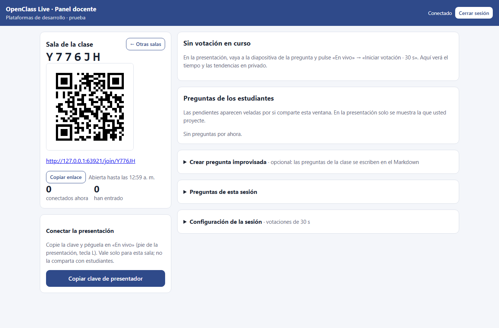

Pulse **Copiar clave de presentador**. Esa clave solo sirve para esta sala; no la comparta con estudiantes.

## 3. Conectar la presentación (una vez por clase)

1. En Zoom, comparta **solo la ventana de la presentación** (no la pantalla completa: así el panel docente nunca se ve).
2. Pulse **● En vivo** (o **L**), pegue la clave y pulse **Conectar participación**. La primera vez verá una guía de tres pasos; **Entendido** la oculta (vuelve con **¿Cómo funciona?**).

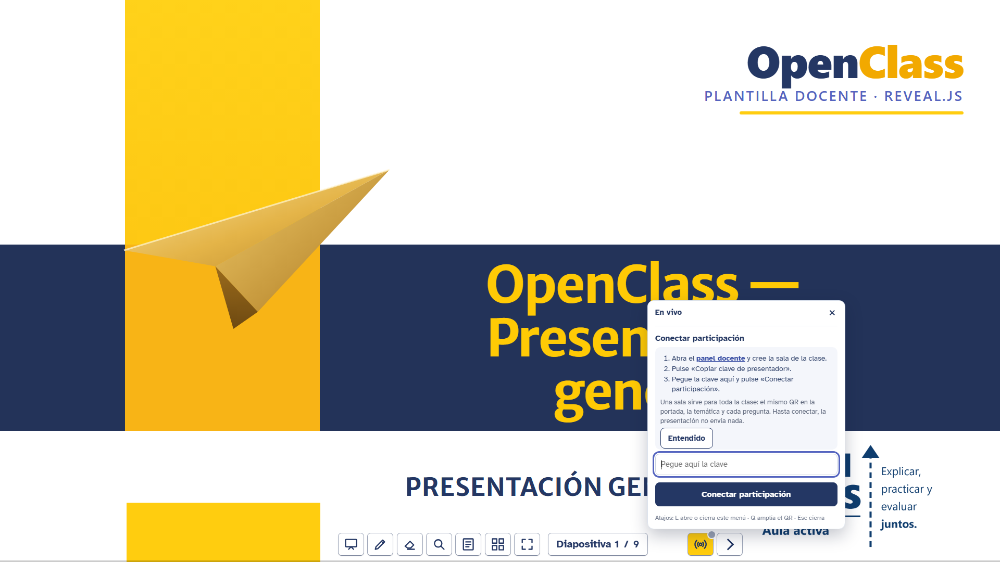

El botón muestra el estado: punto gris (sin conectar), verde con los participantes conectados, rojo con la cuenta regresiva durante una votación y ámbar al terminar o si se está reconectando. Al pasar el mouse o enfocarlo con el teclado aparece una ayuda breve; en pantallas táctiles el propio menú trae las explicaciones.

## 4. Una clase = una sala = un QR

Desde que conecta, y nunca antes (no hay QR de ejemplo), el QR real y el código de **la misma sala** aparecen solos:

- **Portada:** junto a la franja amarilla, con «Participa durante la sesión».

  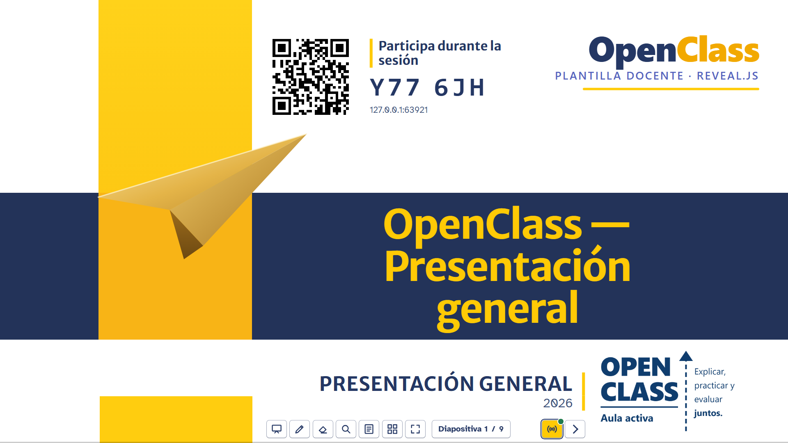

- **Segunda diapositiva (temática):** bloque de participación con el QR, la dirección y el código.

  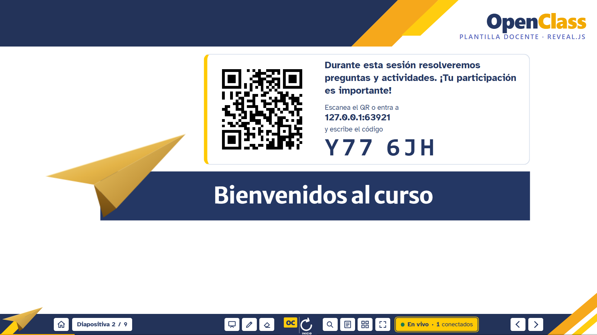

- **Cada diapositiva con pregunta:** un QR compacto en una esquina libre (nunca sobre el enunciado, las opciones, el código ni los diagramas; si no hay espacio, solo el código). Durante la votación muestra además el tiempo restante y las respuestas recibidas.

  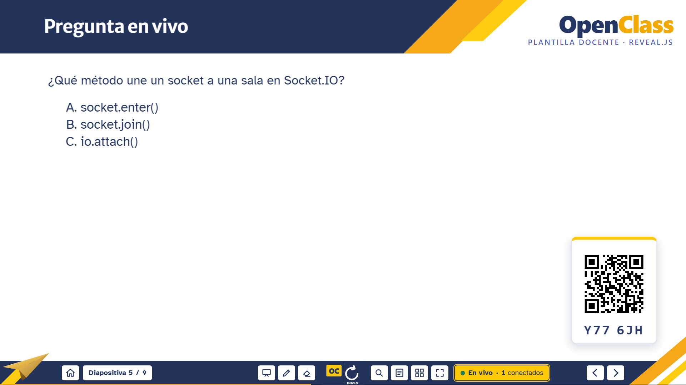

**Pulsar cualquiera de estos QR abre el mismo menú «En vivo».** Desde allí, **Ampliar QR** (o la tecla **Q**) lo muestra grande; **Ocultar QR aquí** (o la **×** de la tarjeta) lo quita solo de esa diapositiva.

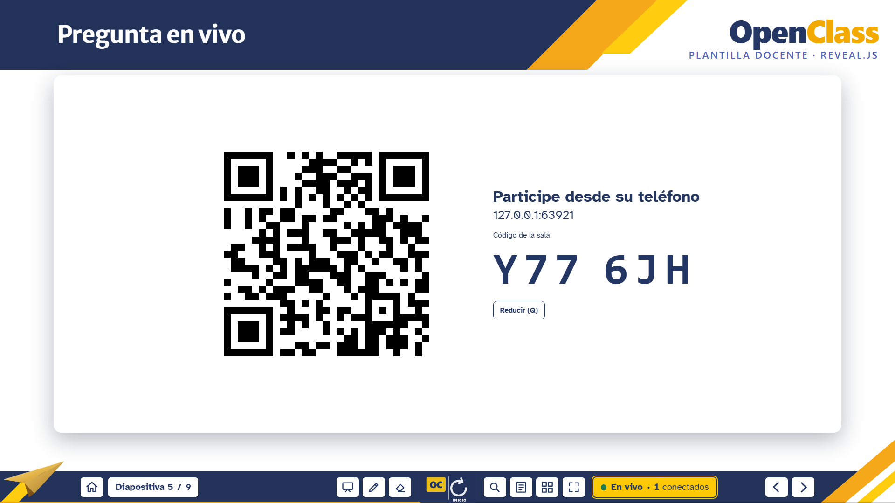

Los estudiantes entran una vez y permanecen conectados toda la sesión. Cambiar de diapositiva no crea otra sala ni desconecta a nadie. Quien llega tarde usa el mismo QR o código: si hay una pregunta abierta la recibe al instante. Nada de esto aparece en el PDF.

## 5. Escribir las preguntas (en el Markdown, una sola vez)

En el Markdown de la semana:

```html
<div class="oc-live-encuesta" data-tipo="unica" data-correctas="B">
<p class="oc-live-enunciado">¿Qué método une un socket a una sala en Socket.IO?</p>
<ol class="oc-live-opciones">
<li>socket.enter()</li>
<li>socket.join()</li>
<li>io.attach()</li>
</ol>
<div class="oc-live-explicacion">socket.join agrega el socket a una room.<pre><code>socket.join("sala");</code></pre></div>
</div>
```

- `data-tipo="multiple"` permite varias respuestas; `data-correctas="A,C"` marca varias.
- La explicación no se ve en la diapositiva ni en el PDF (con OpenClass Live encendido o apagado): aparece solo cuando usted la revela.
- Al iniciar la votación salen de su computador **solo** el enunciado, el código y las opciones; la respuesta correcta y la explicación se quedan en él hasta que pulse **Revelar explicación**. El resto de la presentación, las notas y las imágenes nunca salen.
- No hay que indicar el tiempo: todas las preguntas usan el tiempo de la sesión (30 s por omisión).

Para una pregunta que surja en clase: en el panel, **Crear pregunta improvisada** (plegado por omisión). La correcta y la explicación que marque ahí se guardan solo en esa pestaña del navegador (sobreviven a recargarla mientras siga en la misma sala; se pierden si la cierra, vuelve a «Otras salas», cierra sesión o la sesión vence antes de revelar; si deja a medio escribir una pregunta improvisada, el panel pide confirmación antes de descartarla) y se revelan desde el mismo panel.

## 6. Votar

En la diapositiva de la pregunta, **● En vivo → Iniciar votación · 30 s**. Los estudiantes la ven al instante, con la cuenta regresiva:

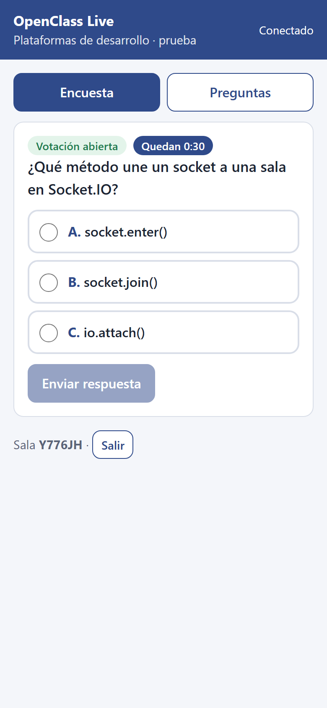

Durante la votación:

- La diapositiva queda visible; ninguna capa la tapa. El botón del pie y la tarjeta QR muestran el tiempo y las respuestas.
- **Cerrar ahora** termina antes; **+30 segundos** da más tiempo.
- En el panel docente ve las **tendencias en vivo** (barras por opción, cantidad, porcentaje, total y tiempo), solo para usted y sin marcar la correcta.

  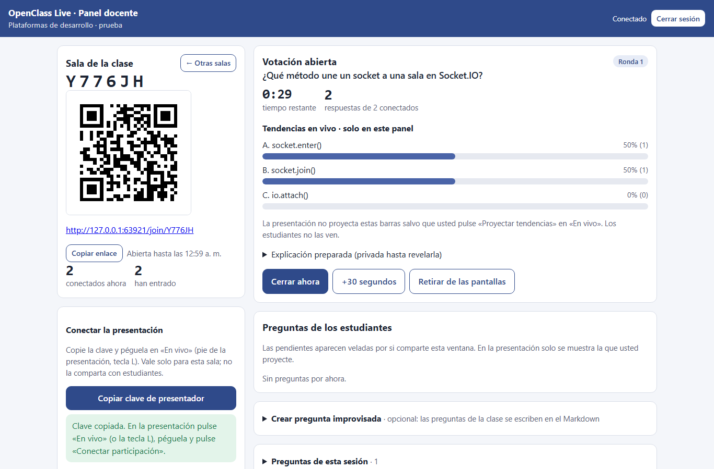

- **Proyectar tendencias** las muestra a todos en la presentación (desactivado por omisión; nunca incluye la respuesta correcta). Se apaga sola al terminar la votación.

  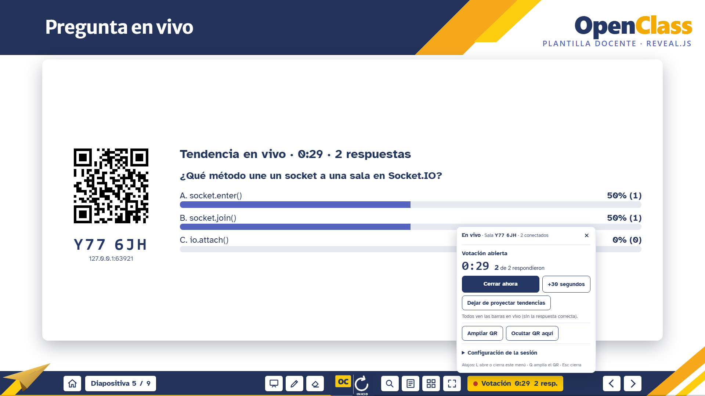

Al llegar a cero, **el servidor cierra la votación**, aunque su computador se haya desconectado. Cerrar no publica resultados ni revela la respuesta: el menú pasa a **Votación finalizada** con una sola acción, **Mostrar resultados**.

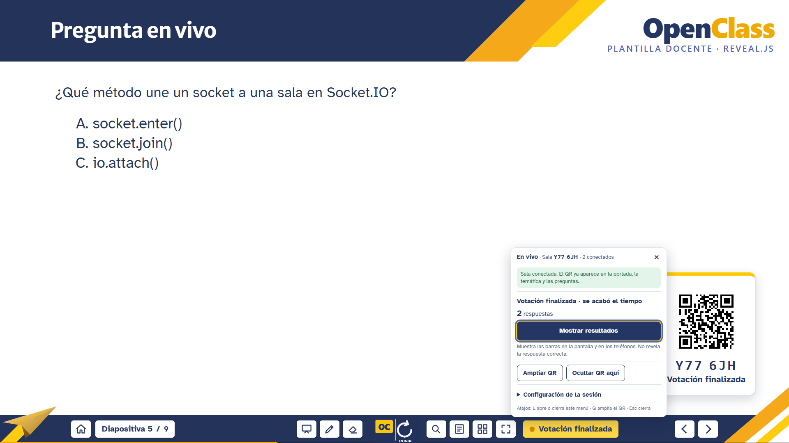

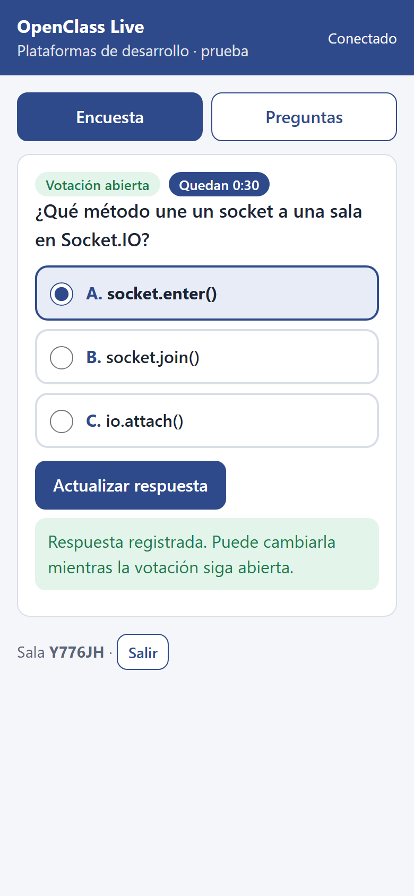

## 7. Resultados, segunda ronda y explicación

Secuencia recomendada: **pregunta → respuesta individual → discusión en parejas → segunda respuesta → explicación**.

1. **Mostrar resultados**: barras en la pantalla y en los teléfonos, todavía sin la correcta.
2. **Discutir y repetir**: tras conversar en parejas, abre la segunda ronda con el mismo tiempo de la sesión.
3. **Revelar explicación**: marca la correcta, muestra la explicación y la comparación con la primera ronda. Se pulsa donde está la solución: en la presentación («En vivo» o Build Tech) para las preguntas de las diapositivas; en el panel para las improvisadas. El panel no conoce la solución de una pregunta de la presentación y lo indica. El porcentaje de acierto aparece solo después de revelar.

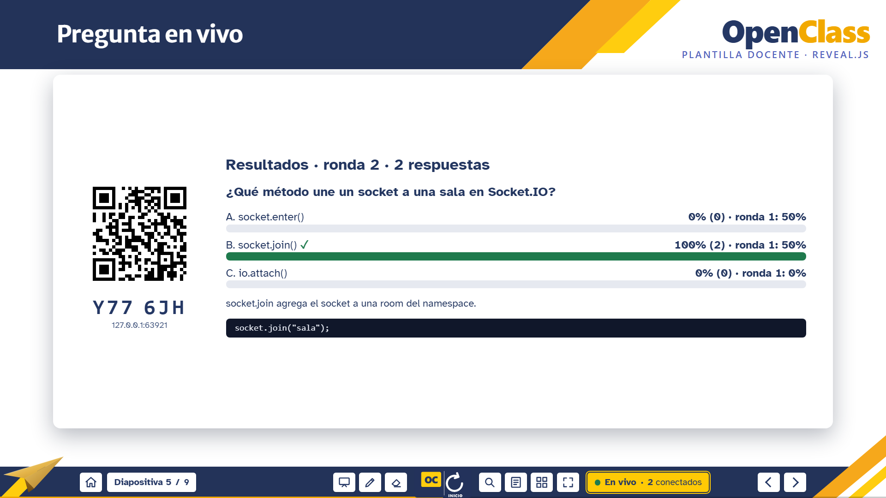

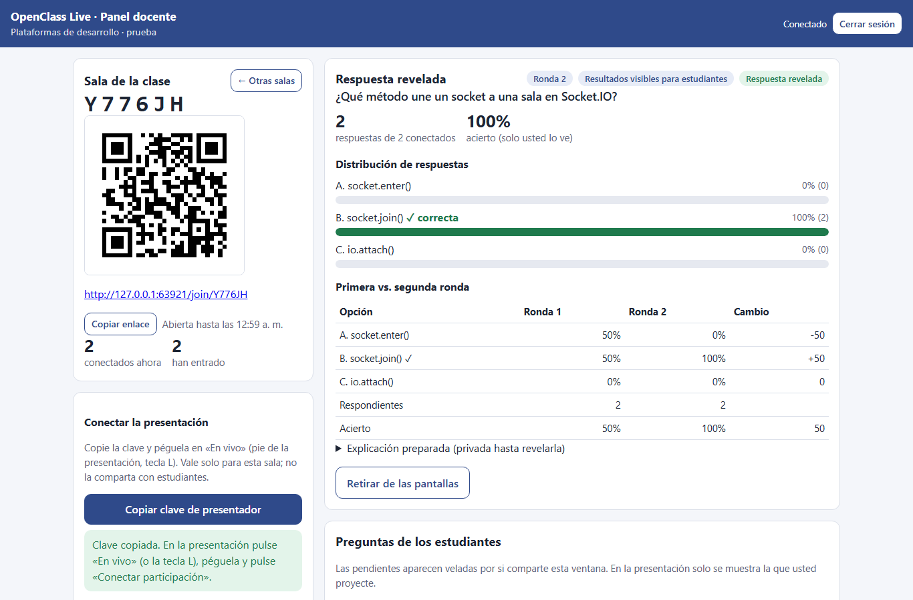

Los estudiantes ven si acertaron y la explicación:

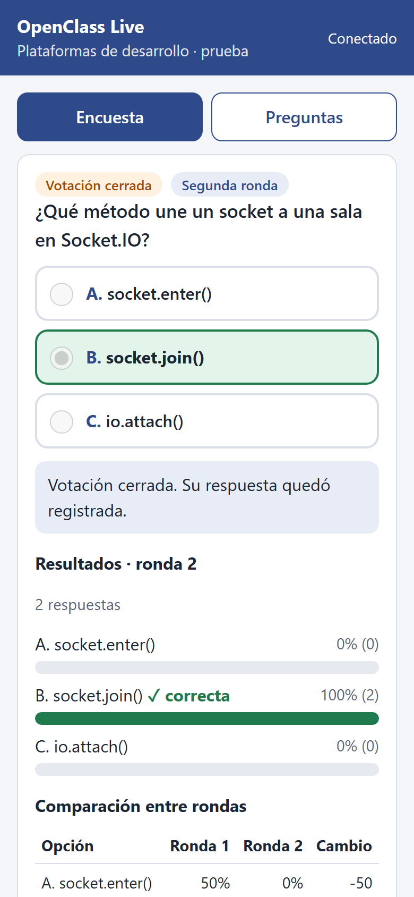

Luego avance a la siguiente diapositiva: la sala, el QR, los participantes y el tiempo de votación se conservan. **Quitar de la pantalla** oculta los resultados sin cambiar nada más.

## 8. Tiempo de votación (una preferencia para toda la sesión)

**● En vivo → Configuración de la sesión** (o la misma sección del panel): 15, 30, 60 o 90 segundos; **Sin límite** está en «Opción avanzada». El cambio se aplica a las **próximas** votaciones; una votación en curso conserva su tiempo. La preferencia dura lo que dure la sala.

## 9. Responder preguntas de los estudiantes

Los estudiantes escriben en la pestaña **Preguntas**. Con la revisión activada, nadie más las ve hasta que usted las apruebe, y nunca aparecen en la presentación por sí solas.

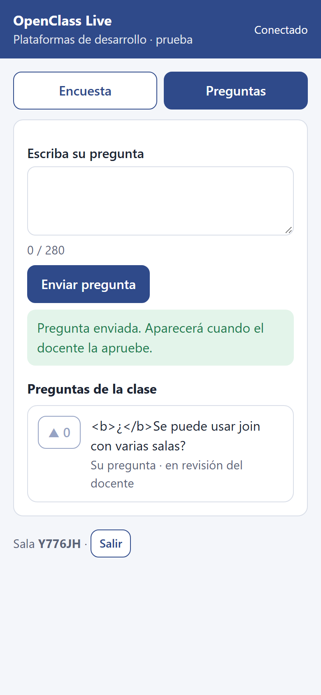

En el panel, las pendientes aparecen veladas (por si comparte esa ventana): **Leer**, **Aprobar**, **Proyectar en la presentación**, **Marcar respondida**, **Ocultar** o **Bloquear autor**. «Recibir preguntas» y «Revisar antes de publicar» están en **Configuración de la sesión**.

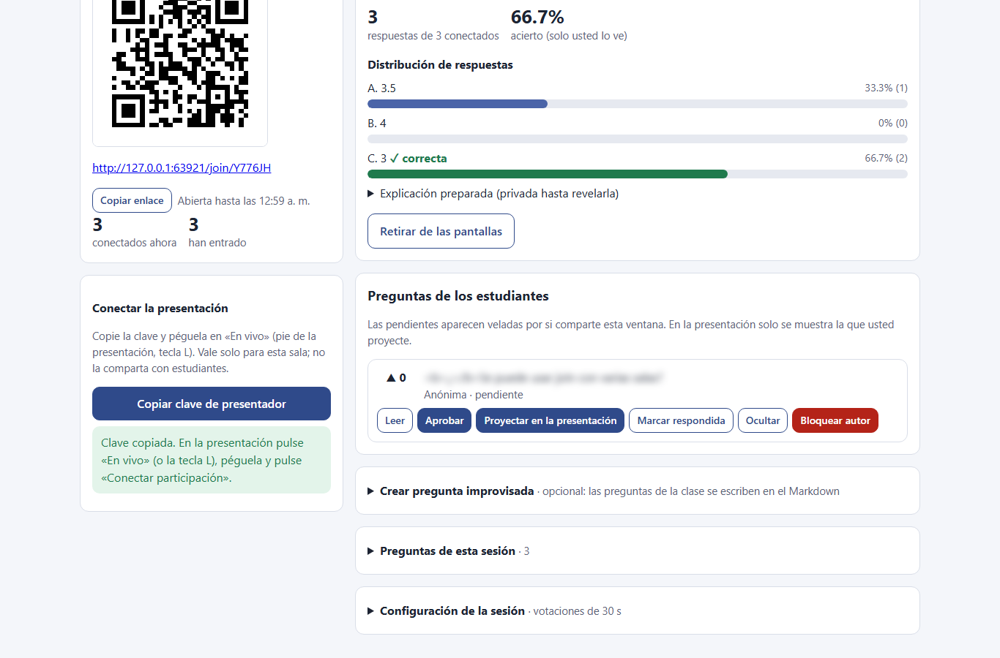

La pregunta proyectada aparece como una banda sobre la diapositiva; el texto se muestra tal cual, sin interpretar HTML:

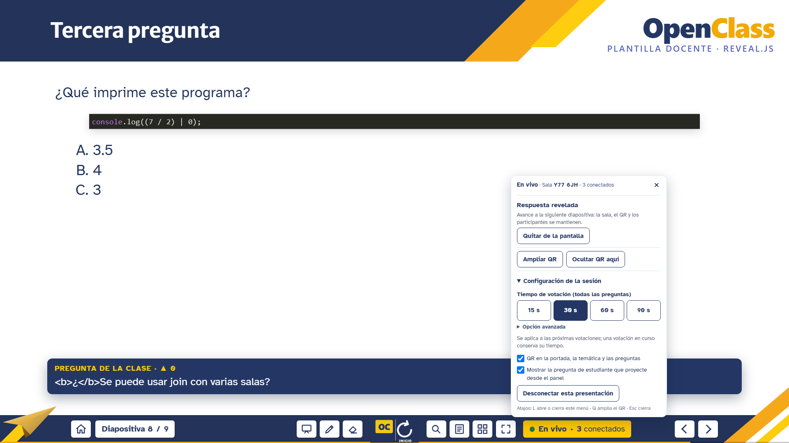

## 10. Cerrar la sesión

Al terminar: **Configuración de la sesión → Finalizar sesión** en el panel (pide confirmación). Se borran del servidor encuestas, respuestas y preguntas; los estudiantes ven «La sesión terminó». En la presentación, **Configuración de la sesión → Desconectar esta presentación**.

## Build Tech: dirigir la clase desde el segundo monitor

**Build Tech** es una ventana privada para su segundo monitor (o el mismo computador): nunca la comparta. Ábrala con el botón **Vista del presentador** del pie azul → **Build Tech**, o con la tecla **T**; arrástrela al otro monitor y comparta por Zoom solo la pestaña de la presentación. Las notas clásicas de Reveal.js (tecla **S**) siguen disponibles.

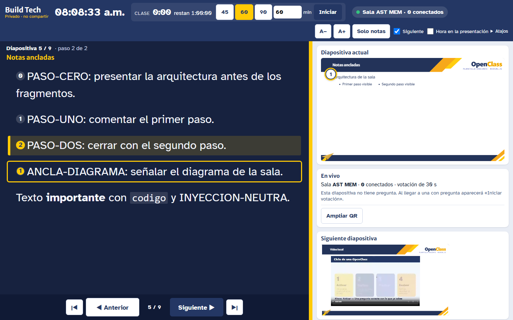

- **Notas** (lo más grande): las `Notes:` de cada diapositiva, en letra grande (**A−/A+**), con el punto de lectura resaltado si usó `[[0]]`, `[[1]]`… y modo **Solo notas** (tecla **N**). Las notas ancladas (`[[#mapa]]` + `data-oc-nota="mapa"`) muestran un número sobre la miniatura privada; al pulsarlo se destaca su nota. Nada de esto aparece en la pantalla compartida.
- **Navegación**: **◀ Anterior / Siguiente ▶** (paso a paso, con fragmentos) y **|◀ / ▶|** (diapositiva completa); también ←, →, Espacio, AvPág y RePág. La presentación siempre manda: si cierra Build Tech, la clase sigue igual.
- **Tres relojes independientes**: la hora; el **tiempo de clase** (elija 45, 60, 90 o los minutos que quiera e **Iniciar**; **Pausar**, **Reanudar**, **Reiniciar…** con confirmación; al terminar solo avisa, la sala En vivo no se cierra); y el **tiempo de votación** (el global de la sala, 30 s por defecto). Cambiar de pregunta nunca reinicia el tiempo de clase. **Hora en la presentación** muestra, solo si la activa, una hora pequeña en la pantalla compartida.
- **Multimedia**: reproducir, pausar, reiniciar, posición, volumen y silencio del video o audio de la diapositiva, y de los videos de YouTube (API oficial). Suena solo la presentación; las miniaturas nunca reproducen. Si el navegador bloquea el sonido, pulse una vez sobre la presentación. Otros proveedores muestran «Control externo no disponible».

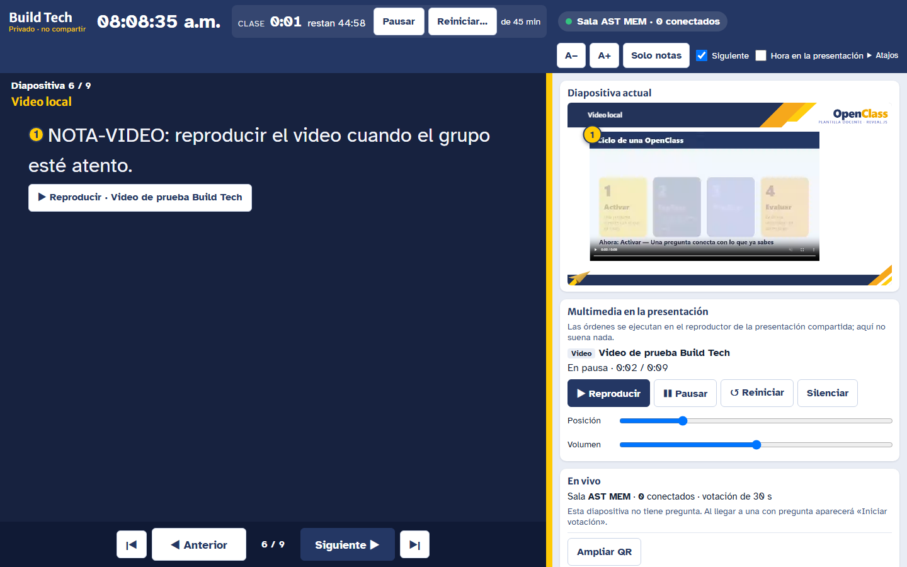

- **En vivo**: con la sala conectada en la presentación (la clave se pega allí, nunca en Build Tech), las mismas acciones del menú «En vivo»: iniciar la votación de la diapositiva, ver las tendencias A/B/C/D en privado, **+30 segundos**, **Cerrar ahora**, **Mostrar resultados**, **Discutir y repetir**, **Revelar explicación**, **Retirar encuesta**, ampliar el QR y moderar las preguntas de los estudiantes. Nada se proyecta sin que usted lo pulse.
- **Solución privada**: plegada; al abrirla ve la respuesta correcta y la explicación sin publicarlas.

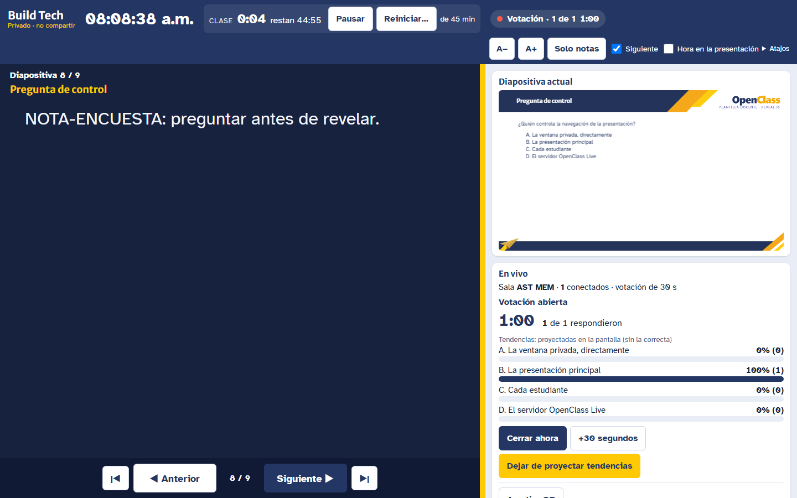

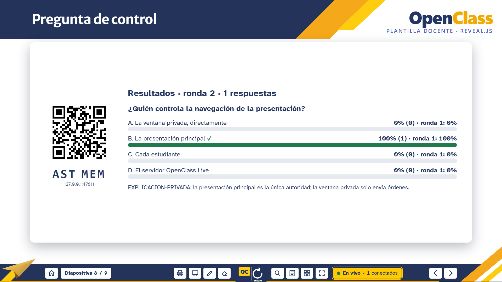

Privacidad: Build Tech se comunica con la presentación solo dentro del navegador (misma computadora, mismo origen); no envía notas ni estado al servidor. Recuerde que las `Notes:` de un curso **publicado** en GitHub Pages viajan con sus diapositivas: Build Tech no las proyecta, pero no las vuelve secretas.

## Exportar a PDF

El botón de impresora **Exportar a PDF** del pie azul abre una pestaña con todas las diapositivas de la semana y el diálogo de impresión: elija **Guardar como PDF** (horizontal, «Gráficos de fondo» activado). El PDF lleva una página 16:9 por diapositiva, sin notas, soluciones, QR, controles ni capas de En vivo; cada video integrado aparece como su título y su enlace.

## 11. Teclado y accesibilidad

- **L** abre o cierra «En vivo»; el foco va a la acción principal del momento. **Esc** lo cierra y devuelve el foco al botón.
- **Q** amplía o reduce el QR.
- **T** abre Build Tech; dentro de Build Tech: ← → navegan, **N** solo notas, **+ / −** letra, **L** lleva a En vivo.
- Tabulador recorre las acciones; Espacio e Intro las activan sin cambiar de diapositiva.

## 12. Si se pierde la conexión

- **Un estudiante** (pantalla bloqueada, cambió de red): vuelve solo o recargando el mismo enlace; conserva su respuesta.
- **Su presentación**: se reconecta sola («Reconectando…» en el botón). Si recarga la página, recupera la sala y continúa donde quedó; una votación que venció mientras tanto aparece como **Votación finalizada**. Si dice que la clave no es válida o venció, copie una nueva desde el panel.
- **El panel**: recargue la página; vuelve a la sala abierta.
- **Si el servidor se reinició**, las salas abiertas se pierden (se guardan solo en memoria): cree una sala nueva y conecte de nuevo.
- La presentación funciona siempre aunque OpenClass Live no esté disponible.

Nota: la participación es anónima. El sistema evita votos duplicados por accidente, pero no puede garantizar un voto por persona si alguien usa varios dispositivos.
