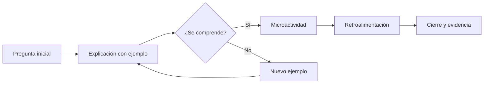

# TEMÁTICA DE PRUEBA
<!-- .slide: id="portada" class="oc-demo oc-l-cover" data-background-image="{{BASE_URL}}fondos/slide-01-portada.png" data-background-size="cover" -->

**DEMOSTRACIÓN COMPLETA**

OpenClass · Reveal.js

Notes:
Portada institucional (layout oc-l-cover). El título va en un encabezado de nivel 1; el primer párrafo en negrita es el bloque de semana y el segundo, la fecha o el subtítulo. Esta presentación es un recurso de referencia: no corresponde a una semana del curso.

---

## Recorrido por OpenClass
<!-- .slide: id="separador" class="oc-demo oc-l-section" data-background-image="{{BASE_URL}}fondos/slide-05-template.png" data-background-size="cover" -->

<div class="oc-section-plane"></div>

Notes:
Separador de unidad (oc-l-section). Úsalo para anunciar un bloque temático nuevo y dar una pausa visual. Solo lleva el título y el avión decorativo.

---

## Resultados de aprendizaje
<!-- .slide: id="resultados" class="oc-demo oc-l-objectives" data-background-image="{{BASE_URL}}fondos/slide-05-template.png" data-background-size="cover" -->

Al terminar esta demostración podrás:

1. Elegir el layout adecuado para cada propósito de la clase.
2. Insertar imágenes, video, fórmulas, diagramas y gráficos.
3. Mostrar programas extensos con scroll o con paginación.
4. Incorporar una microactividad con retroalimentación.
5. Usar notas, vista del presentador y herramientas de pizarra.

Notes:
Layout oc-l-objectives: lista numerada de resultados verificables. Se recomiendan entre 3 y 6 resultados, redactados con verbos observables (elegir, insertar, mostrar, usar).

---

## Imagen a la izquierda
<!-- .slide: id="imagen-izquierda" class="oc-demo oc-l-image-left" data-background-image="{{BASE_URL}}fondos/slide-05-template.png" data-background-size="cover" -->


- La imagen ocupa la columna izquierda sin recortarse.
- Ideal para un esquema que guía la explicación.
- El texto acompaña con 3 a 5 ideas breves.
- Escribe siempre un texto alternativo descriptivo.

Notes:
Layout oc-l-image-left. Primero la imagen Markdown y luego la lista. La imagen se ajusta a una caja de 455 × 556 px conservando su proporción.

---

## Imagen a la derecha
<!-- .slide: id="imagen-derecha" class="oc-demo oc-l-image-right" data-background-image="{{BASE_URL}}fondos/slide-05-template.png" data-background-size="cover" -->


- Variante espejo: el texto se lee primero.
- Útil cuando la idea precede al ejemplo visual.
- Guarda tus imágenes en public/imagenes/.
- Usa nombres de archivo sin espacios ni tildes.

Notes:
Layout oc-l-image-right. La estructura Markdown es idéntica a la de imagen a la izquierda; solo cambia la clase.

---

## Título superior izquierdo
<!-- .slide: id="titulo-izquierdo" class="oc-demo oc-l-top-left" data-background-image="{{BASE_URL}}fondos/slide-05-template.png" data-background-size="cover" -->


- El título encabeza la banda superior.
- La lista queda a la izquierda, bajo el título.
- La imagen aporta la evidencia a la derecha.
- Funciona bien para presentar datos o resultados.

Notes:
Layout oc-l-top-left: lista a la izquierda e imagen a la derecha, con el título en la banda superior.

---

## Título superior derecho
<!-- .slide: id="titulo-derecho" class="oc-demo oc-l-top-right" data-background-image="{{BASE_URL}}fondos/slide-05-template.png" data-background-size="cover" -->


- La imagen abre la lectura a la izquierda.
- La lista se ubica a la derecha de la imagen.
- Adecuado para casos, escenarios o personajes.
- Con 4 viñetas o menos, el texto se amplía solo.

Notes:
Layout oc-l-top-right: imagen a la izquierda y lista a la derecha. Si la lista tiene 4 elementos o menos, el tema aumenta el tamaño de letra automáticamente.

---

## Texto desarrollado
<!-- .slide: id="texto" class="oc-demo oc-l-text" data-background-image="{{BASE_URL}}fondos/slide-05-template.png" data-background-size="cover" -->

El primer párrafo se destaca como idea central de la diapositiva.

- Las viñetas desarrollan la idea con frases completas y breves.
- Puedes usar **negrita**, *cursiva*, `código en línea` y [enlaces](https://revealjs.com).
- Aparición progresiva de una idea. <!-- .element: class="fragment fade-in" -->
- Si el texto es largo, activa `data-oc-paginate="auto"`. <!-- .element: class="fragment fade-in" -->

Notes:
Layout oc-l-text. Las dos últimas viñetas usan fragmentos: aparecen al avanzar. Para textos extensos, el atributo data-oc-paginate="auto" crea diapositivas de continuación con el mismo título.

---

## Dos columnas
<!-- .slide: id="dos-columnas" class="oc-demo oc-l-two-cols" data-background-image="{{BASE_URL}}fondos/slide-05-template.png" data-background-size="cover" -->

| Antes de la sesión | Durante la sesión |
|:---|:---|
| Revisar el material | Activar con una pregunta |
| Preparar la actividad | Explicar con ejemplos |
| Probar enlaces y videos | Practicar en parejas |
| Escribir notas | Evaluar y retroalimentar |

Notes:
Layout oc-l-two-cols: una tabla Markdown de dos columnas. Los encabezados de la tabla se convierten en las cabeceras azules de cada columna.

---

## Dos títulos
<!-- .slide: id="dos-titulos" class="oc-demo oc-l-two-titles" data-background-image="{{BASE_URL}}fondos/slide-05-template.png" data-background-size="cover" -->

| Modo scroll | Modo paginado |
|:---|:---|
| Todo el programa en una diapositiva | Varias diapositivas de 16 líneas |
| Rueda, flechas o barra de desplazamiento | Avance normal de Reveal |
| Ideal para recorrer un programa completo | Ideal para PDF e impresión |
| Opción predeterminada | data-oc-paginate="code" |

Notes:
Layout oc-l-two-titles: misma estructura que dos columnas, pensada para comparar dos conceptos con su propio título.

---

## Código fuente
<!-- .slide: id="codigo" class="oc-demo oc-l-code" data-background-image="{{BASE_URL}}fondos/slide-05-template.png" data-background-size="cover" -->

```python [1-3|5-9|11-12]
def promedio(notas):
    """Devuelve el promedio de una lista de notas."""
    return sum(notas) / len(notas)

def estado(nota):
    if nota >= 4.0:
        return "Destacado"
    if nota >= 3.0:
        return "Aprobado"
    return "En refuerzo"

notas = [3.5, 4.2, 2.8, 4.8]
print(round(promedio(notas), 2), estado(promedio(notas)))
```

Notes:
Layout oc-l-code con resaltado por pasos: escribir python [1-3|5-9|11-12] después de las comillas de apertura del bloque ilumina cada grupo de líneas al avanzar. El botón «Copiar código» copia el programa completo.

---

## Código desplazable (scroll)
<!-- .slide: id="codigo-scroll" class="oc-demo oc-l-code" data-background-image="{{BASE_URL}}fondos/slide-05-template.png" data-background-size="cover" -->

```javascript
// Registro de asistencia y participación de una sesión (modo scroll predeterminado).
const estudiantes = [
  { nombre: 'Ana', asistencia: true, participaciones: 3 },
  { nombre: 'Bruno', asistencia: true, participaciones: 1 },
  { nombre: 'Carla', asistencia: false, participaciones: 0 },
  { nombre: 'Diego', asistencia: true, participaciones: 4 },
  { nombre: 'Elena', asistencia: true, participaciones: 2 },
];

function nivel(participaciones) {
  if (participaciones >= 4) return 'alta';
  if (participaciones >= 2) return 'media';
  return 'baja';
}

function resumen(lista) {
  const presentes = lista.filter((e) => e.asistencia);
  const total = presentes.reduce((suma, e) => suma + e.participaciones, 0);
  return {
    presentes: presentes.length,
    ausentes: lista.length - presentes.length,
    promedio: presentes.length ? total / presentes.length : 0,
  };
}

function reporte(lista) {
  const filas = lista.map((e) => `${e.nombre.padEnd(8)} | ${e.asistencia ? 'presente' : 'ausente '} | participación ${nivel(e.participaciones)} (${e.participaciones})`);
  const r = resumen(lista);
  filas.push('-'.repeat(60));
  filas.push(`Presentes: ${r.presentes} · Ausentes: ${r.ausentes} · Promedio de participaciones: ${r.promedio.toFixed(1)} por estudiante presente`);
  return filas.join('\n');
}

function recomendaciones(lista) {
  return lista
    .filter((e) => e.asistencia && nivel(e.participaciones) === 'baja')
    .map((e) => `Invitar a ${e.nombre} a compartir su respuesta en la próxima actividad.`);
}

console.log(reporte(estudiantes));
for (const consejo of recomendaciones(estudiantes)) {
  console.log(consejo);
}
// Fin del programa: 45 líneas visibles en una sola diapositiva con desplazamiento.
```

Notes:
Modo SCROLL (predeterminado): todo el programa permanece en una diapositiva. Desplázate con la rueda, la barra o las flechas tras hacer clic en el código; mientras quede recorrido, las flechas no cambian de diapositiva. La línea de reporte es larga a propósito para mostrar el desplazamiento horizontal.

---

## Código paginado
<!-- .slide: id="codigo-paginado" class="oc-demo oc-l-code" data-background-image="{{BASE_URL}}fondos/slide-05-template.png" data-background-size="cover" data-oc-paginate="code" -->

```python
# Simulación de un termómetro con alertas (modo paginado: data-oc-paginate="code").
import random

UMBRAL_ALTO = 30.0
UMBRAL_BAJO = 15.0

def leer_temperatura():
    """Simula una lectura entre 10 y 35 grados."""
    return round(random.uniform(10, 35), 1)

def clasificar(temperatura):
    if temperatura >= UMBRAL_ALTO:
        return "ALTA"
    if temperatura <= UMBRAL_BAJO:
        return "BAJA"
    return "NORMAL"

def accion(estado):
    acciones = {
        "ALTA": "Encender ventilación",
        "BAJA": "Encender calefacción",
        "NORMAL": "Sin acción",
    }
    return acciones[estado]

def registrar(historial, temperatura, estado):
    historial.append({"t": temperatura, "estado": estado})
    if len(historial) > 10:
        historial.pop(0)

def resumen(historial):
    if not historial:
        return "Sin lecturas"
    promedio = sum(r["t"] for r in historial) / len(historial)
    alertas = sum(1 for r in historial if r["estado"] != "NORMAL")
    return f"Promedio {promedio:.1f} °C · {alertas} alertas"

historial = []
for _ in range(5):
    t = leer_temperatura()
    e = clasificar(t)
    registrar(historial, t, e)
    print(t, e, accion(e))
print(resumen(historial))
```

Notes:
Modo PAGINACIÓN: data-oc-paginate="code" divide el bloque en diapositivas de 16 líneas con el título «(continuación N)». Cambia el tamaño con data-oc-lines="20". Útil para exportar a PDF. Para ejecutar el ejemplo hay que reunir todos los fragmentos.

---

## Tabla de información
<!-- .slide: id="tabla" class="oc-demo oc-l-two-cols" data-background-image="{{BASE_URL}}fondos/slide-05-template.png" data-background-size="cover" -->

| Recurso | Layout | Carpeta | Comprobar |
|:---|:---|:---|:---|
| Imagen | image-left / right | public/imagenes/ | Texto alternativo |
| Video | multimedia | public/videos/ | Subtítulos |
| Actividad | multimedia | public/actividades/ | Prueba en iframe |
| Código | code | (en el Markdown) | Scroll o paginado |

Notes:
Las tablas Markdown admiten más de dos columnas en los layouts de columnas. Mantén celdas breves: el tema no reduce la letra para que quepa más texto.

---

## Multimedia: video propio con subtítulos
<!-- .slide: id="video" class="oc-demo oc-l-multimedia" data-background-image="{{BASE_URL}}fondos/slide-05-template.png" data-background-size="cover" -->

<video controls preload="metadata" src="{{BASE_URL}}videos/demo-openclass.webm" aria-label="Animación del ciclo de una OpenClass"><track kind="captions" src="{{BASE_URL}}videos/demo-openclass.vtt" srclang="es" label="Español" default></video>

Notes:
Layout oc-l-multimedia: el video ocupa toda el área útil sin recortarse. Guarda los archivos en public/videos/ y agrega subtítulos .vtt. Para YouTube o Vimeo usa un iframe con la URL de inserción y verifica antes que el video permita incrustarse.

---

## Fórmulas matemáticas
<!-- .slide: id="formulas" class="oc-demo oc-l-text" data-background-image="{{BASE_URL}}fondos/slide-05-template.png" data-background-size="cover" -->

KaTeX convierte la notación LaTeX en fórmulas legibles.

Promedio ponderado de una evaluación:

$$\bar{x} = \frac{\sum_{i=1}^{n} w_i\, x_i}{\sum_{i=1}^{n} w_i}$$

Fórmula en línea: la nota final es $N = 0{,}3P + 0{,}7E$.

Notes:
Usa $$ … $$ para fórmulas centradas y $ … $ dentro del texto. KaTeX se descarga de un CDN: sin conexión, las fórmulas se muestran como texto LaTeX. Verifica la conexión antes de la clase.

---

## Diagrama Mermaid
<!-- .slide: id="mermaid" class="oc-demo oc-l-multimedia" data-background-image="{{BASE_URL}}fondos/slide-05-template.png" data-background-size="cover" -->



Notes:
Un bloque de código con lenguaje mermaid se convierte en diagrama al cargar la presentación. Sirve para procesos, decisiones y mapas conceptuales. Mermaid se incluye en el proyecto y funciona sin conexión.

---

## Gráfico con Chart
<!-- .slide: id="chart" class="oc-demo oc-l-multimedia" data-background-image="{{BASE_URL}}fondos/slide-05-template.png" data-background-size="cover" -->

<div class="oc-chart"><canvas data-chart="bar">
<!-- { "options": { "plugins": { "legend": { "position": "bottom" } } } } -->
Momento,Activar,Explicar,Practicar,Evaluar
Minutos previstos,10,25,35,20
Participaciones,12,6,28,15
</canvas></div>

Notes:
El plugin Chart lee datos en formato CSV dentro de un canvas con data-chart (bar, line, pie, doughnut, radar). La primera fila son las etiquetas; cada fila siguiente es una serie. Los colores siguen la paleta del tema.

---

## Actividad mediante iframe
<!-- .slide: id="actividad-iframe" class="oc-demo oc-l-multimedia" data-background-image="{{BASE_URL}}fondos/slide-05-template.png" data-background-size="cover" -->

<iframe title="Microactividad: clasifica los momentos de una sesión activa" src="{{BASE_URL}}actividades/microactividad/index.html" loading="lazy" sandbox="allow-scripts allow-forms" style="width:100%;height:100%;border:0"></iframe>

Notes:
Microactividad de 5 a 10 minutos: los estudiantes clasifican acciones, comprueban, leen la retroalimentación y pueden reintentar. Para cambiar el tema se edita solo public/actividades/microactividad/datos.js. El sandbox impide que la actividad acceda a la presentación.

---

## Pregunta de repaso
<!-- .slide: id="pregunta" class="oc-demo oc-l-text" data-background-image="{{BASE_URL}}fondos/slide-05-template.png" data-background-size="cover" -->

¿Qué layout usarías para comparar dos enfoques de una misma solución?

- Piensa durante 30 segundos y escribe tu respuesta en el chat.
- **Respuesta:** dos títulos (oc-l-two-titles), con una columna por enfoque. <!-- .element: class="fragment highlight-blue" -->
- Alternativa válida: dos columnas, si no necesitas títulos destacados. <!-- .element: class="fragment fade-in" -->

Notes:
Pregunta de repaso con respuesta oculta: los fragmentos revelan la respuesta cuando el docente avanza. Da tiempo de pensar antes de mostrarla.

---

## Actividad práctica
<!-- .slide: id="actividad-practica" class="oc-demo oc-l-objectives" data-background-image="{{BASE_URL}}fondos/slide-05-template.png" data-background-size="cover" -->

En 10 minutos, crea tu primera diapositiva:

1. Abre semanas/&lt;curso&gt;_semana1.md en VS Code.
2. Copia un layout desde la galería con «Copiar código».
3. Cambia el título, el texto y la imagen.
4. Guarda y observa el cambio en el navegador.
5. Comparte una captura con tu grupo.

Notes:
Actividad práctica guiada con pasos numerados y tiempo definido. Recorre el aula virtual mientras trabajan y recoge dudas para el cierre.

---

## Notas del presentador
<!-- .slide: id="notas" class="oc-demo oc-l-text" data-background-image="{{BASE_URL}}fondos/slide-05-template.png" data-background-size="cover" -->

Las notas acompañan al docente y no las ve el público.

- Escribe Notes: al final de la diapositiva y debajo, tu guion.
- Pulsa S o el botón del presentador para abrir la vista con notas y cronómetro.
- La barra inferior incluye pizarra, anotación, búsqueda y vista general.
- El botón central del pie vuelve a la primera diapositiva.

Notes:
Esta es una nota del presentador: aparece en la ventana que abre la tecla S, junto con la diapositiva siguiente y el tiempo transcurrido. Úsala para preguntas guía, tiempos y recordatorios.

---

## Qué permite cada recurso
<!-- .slide: id="resumen" class="oc-demo oc-l-two-titles" data-background-image="{{BASE_URL}}fondos/slide-05-template.png" data-background-size="cover" -->

| Recurso | Qué consigue en clase |
|:---|:---|
| Video y multimedia | Mostrar un proceso real o una demostración |
| Fórmulas y Mermaid | Representar relaciones, procesos y decisiones |
| Chart | Leer datos y comparar resultados |
| Iframe y actividades | Practicar con retroalimentación inmediata |

Notes:
Resumen pedagógico de los recursos multimedia: elige el recurso según la acción que quieres provocar en los estudiantes.

---

## Para terminar
<!-- .slide: id="cierre" class="oc-demo oc-l-closing" data-background-image="{{BASE_URL}}fondos/slide-06-cierre.png" data-background-size="cover" -->

Notes:
Cierre institucional (oc-l-closing): el fondo contiene el mensaje GRACIAS. El título solo se conserva para lectores de pantalla y la vista general.
