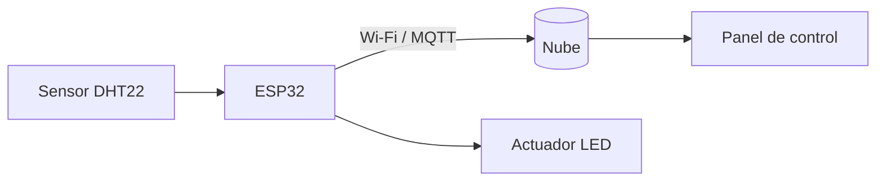

# Laboratorio interactivo de OpenClass
<!-- .slide: class="oc-demo oc-l-cover" data-background-image="{{BASE_URL}}fondos/slide-01-portada.png" data-background-size="cover" -->

**Pruebas de interacción**

2026

---

## Actividad 1 — Sensores y actuadores
<!-- .slide: class="oc-demo oc-l-multimedia" data-background-image="{{BASE_URL}}fondos/slide-05-template.png" data-background-size="cover" -->

<iframe title="Laboratorio de sensores" src="{{BASE_URL}}actividades/laboratorio-sensores.html" loading="lazy" sandbox="allow-scripts allow-forms" style="width:100%;height:100%;border:0"></iframe>

Notes:
Pedir que modifiquen la temperatura y observen el actuador.

---

## Actividad 2 — Preguntas de IoT
<!-- .slide: class="oc-demo oc-l-multimedia" data-background-image="{{BASE_URL}}fondos/slide-05-template.png" data-background-size="cover" -->

<iframe title="Cuestionario IoT" src="{{BASE_URL}}actividades/quiz-iot.html" loading="lazy" sandbox="allow-scripts allow-forms" style="width:100%;height:100%;border:0"></iframe>

Notes:
La puntuación es local; no es una encuesta compartida con otros estudiantes.

---

## Simuladores y páginas web
<!-- .slide: class="oc-demo oc-l-text" data-background-image="{{BASE_URL}}fondos/slide-05-template.png" data-background-size="cover" -->

Puedes incorporar simuladores alojados en tu mismo dominio y aplicaciones externas que permitan `iframe`.

- Verifica que la página admita incrustación mediante CSP o X-Frame-Options.
- Si bloquea la incrustación, abre el simulador en una pestaña externa.
- Mantén el control de la navegación en la presentación.

---

## Diagrama con Mermaid
<!-- .slide: class="oc-demo oc-l-multimedia" data-background-image="{{BASE_URL}}fondos/slide-05-template.png" data-background-size="cover" -->

Notes:
Los bloques de código con lenguaje `mermaid` se convierten en diagramas al cargar la presentación.

---

## Gráfico con Chart.js
<!-- .slide: class="oc-demo oc-l-multimedia" data-background-image="{{BASE_URL}}fondos/slide-05-template.png" data-background-size="cover" -->

<canvas data-chart="bar">
<!-- { "options": { "plugins": { "legend": { "position": "bottom" } } } } -->
Lectura,Lun,Mar,Mié,Jue,Vie
Temperatura (°C),21,23,26,24,22
Humedad (%),60,58,65,70,66
</canvas>

---

## Fórmulas con KaTeX
<!-- .slide: class="oc-demo oc-l-text" data-background-image="{{BASE_URL}}fondos/slide-05-template.png" data-background-size="cover" -->

Conversión de la lectura del sensor a grados Fahrenheit:

$$F = \frac{9}{5}C + 32$$

Ley de Ohm para la resistencia del LED: $V = I \cdot R$

Notes:
KaTeX se descarga del CDN; sin conexión las fórmulas se muestran como texto.

---

# ¡Gracias!
<!-- .slide: class="oc-demo oc-l-closing" data-background-image="{{BASE_URL}}fondos/slide-06-cierre.png" data-background-size="cover" -->
